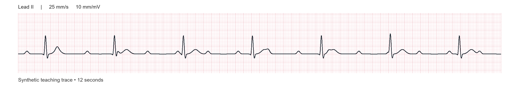

# Question report revisions — 25 October 2026

11 questions revised. The methotrexate dosing question remains removed. Original identifiers and learning objectives are preserved.

## Mixed Bank 1 · mb1-032 · CBT and weight management

**Previous stem**

A patient identifies a pattern: after a stressful shift they think “I have earned food to switch off” and snack despite not being hungry. They want to try a cognitive behavioural approach. Which next step most directly addresses this identified pattern?

**Current stem**

During CBT for weight management, a patient says, “If I do not snack after a stressful shift, I will stay tense all evening.” A diary has established the pattern. Which agreed task would most directly test this prediction?

**What changed**

Changed the task to identifying a behavioural experiment. All five options are plausible CBT or behaviour-change techniques; removed giveaway omissions.

**Current options**

A. Try a ten-minute walk after a shift and compare predicted with actual tension before deciding whether to snack
B. Record snack portions and estimated calories after each shift for the next week
C. Keep snacks in a less accessible cupboard and prepare portions at the start of the week
D. List evidence for and against the thought that a difficult shift deserves a food reward
E. Choose a non-food reward for meeting an agreed weekly snack-frequency target

**Answer: A.** A behavioural experiment tests a specific prediction against experience. Trying another response and comparing expected with actual tension tests whether snacking is necessary for the tension to settle.

**Learning objective**

Discuss the psycho-social factors associated with weight gain and weight loss and explain the principles underpinning cognitive-behavioural weight loss programmes

## Mixed Bank 1 · mb1-036 · Nondisjunction

**Previous stem**

A child has two cell populations: one with 46 chromosomes and another with trisomy 21. Which event best explains this pattern?

**Current stem**

A child has both 46,XX and 47,XX,+21 cell populations. The embryo initially had a normal 46,XX chromosome complement. Which subsequent event best explains the trisomic cell population?

**What changed**

Kept mosaic nondisjunction but specified the embryo’s starting complement. Replaced point-mutation distractors with meiosis I, meiosis II, trisomy rescue and a Robertsonian rearrangement.

**Current options**

A. Failure of homologous chromosome 21 separation during maternal meiosis I
B. Failure of chromosome 21 sister-chromatid separation during maternal meiosis II
C. Loss of one chromosome 21 by anaphase lag in a trisomic embryonic cell
D. A balanced Robertsonian fusion involving chromosomes 14 and 21 in an embryonic cell
E. Failure of chromosome 21 sister-chromatid separation during embryonic mitosis

**Answer: E.** Mitotic nondisjunction in a cell of an initially euploid embryo can produce a trisomic daughter cell. Descendants of unaffected cells retain 46 chromosomes, giving a mosaic pattern.

**Learning objective**

Using molecular insight outline the clinical implications of chromosomal non-disjunction at meiosis I, meiosis II or mitosis

## Mixed Bank 1 · mb1-007 · Arrhythmias

**Previous stem**

An ECG shows regular P waves at 80/min and regular QRS complexes at 35/min, with changing PR intervals and no consistent relationship between atrial and ventricular activity. Which diagnosis best fits?

**Current stem**

A 76-year-old presents with recurrent light-headedness. The rhythm strip below is recorded at 25 mm/s and 10 mm/mV. Which diagnosis best fits?

**What changed**

Removed the textual description of AV dissociation and added a calibrated, zoomable 12-second ECG. Retained the five existing diagnostic options.

**Current options**

A. Mobitz I second-degree AV block
B. Complete heart block
C. Mobitz II second-degree AV block
D. First-degree AV block
E. Sinus bradycardia

**Answer: B.** The strip shows regular P waves at about 80/min and a slower regular QRS rhythm at about 35/min. The P waves march through independently, with changing apparent PR intervals. This supports complete heart block with an escape rhythm.

**Learning objective**

Identify the ECG features of common tachy- and brady-arrhythmias (i.e. atrial fibrillation/flutter, ventricular tachycardia/fibrillation and heart block)

## Mixed Bank 1 · mb1-044 · Breaking bad news

**Previous stem**

After being told that their cancer has spread, a patient becomes silent and tearful. The clinician has not yet discussed treatment options. What is the best immediate response?

**Current stem**

After hearing that their cancer has spread, a patient becomes tearful. The clinician allows a pause. The patient then says, “I thought the treatment had worked.” Which response best explores the patient’s perspective at this point?

**What changed**

Kept the bad-news situation but added a patient statement and a precise communication aim. Replaced insensitive actions with five credible clinician responses of similar length.

**Current options**

A. “Would you like me to explain what the new scan shows?”
B. “Would it help to hear about the treatments we can offer?”
C. “What had you understood about the aim of the treatment?”
D. “Would you like someone close to you to join us?”
E. “What does this news mean for you at the moment?”

**Answer: E.** The open invitation explores the meaning of the news for this patient. It follows their emotional cue without assuming whether the main concern is prognosis, family, treatment or something else.

**Learning objective**

Evaluate the effects of different strategies for breaking bad news.

## Mixed Bank 1 · mb1-045 · Palliative symptom assessment

**Previous stem**

A patient receiving palliative care says their pain is controlled but they cannot sleep because they are worried about how their partner will manage financially. Which next action best addresses the problem described?

**Current stem**

A patient receiving palliative care reports poor sleep despite good pain control. They say, “I am becoming a burden on my partner.” Which question would best guide the next step in a holistic assessment?

**What changed**

Replaced the explicit finances-to-financial-help giveaway with the ambiguous word “burden”. All options are reasonable assessment questions; the task is to avoid prematurely assuming its meaning.

**Current options**

A. “Which personal-care tasks does your partner help you with?”
B. “When you say burden, what are you most concerned about?”
C. “How has your illness affected your household income?”
D. “Have you been feeling low during the daytime as well?”
E. “What support could other family members offer your partner?”

**Answer: B.** Explore what “burden” means to this patient before choosing an intervention. It could refer to practical care, money, relationships, emotional distress or loss of meaning, each suggesting a different assessment and response.

**Learning objective**

Take a history from a patient with a potentially life threatening illness covering physical, psychological, social and spiritual aspects, focusing in particular on the use of listening skills.

## Mixed Bank 1 · mb1-055 · Calf muscle pump

**Previous stem**

During walking, calf muscles compress deep leg veins. Competent valves prevent reflux. How does this assist circulation?

**Current stem**

An ankle-vein pressure recording is taken while a person stands still and then walks. Calf contraction is normal, but the leg’s venous valves are incompetent. Compared with a person with competent valves, what is expected during walking?

**What changed**

Replaced “how does the pump help?” with a prediction of walking venous pressure when valves fail, requiring application of the physiology.

**Current options**

A. A larger sustained fall in ankle venous pressure because blood leaves through more routes
B. A smaller fall in ankle venous pressure because reflux refills emptied veins
C. A similar fall in ankle venous pressure because calf contraction determines the response
D. A smaller fall in ankle venous pressure because valve failure reduces arterial inflow
E. A larger sustained fall in ankle venous pressure because venous capacitance increases

**Answer: B.** Competent valves limit reflux after the calf pump ejects blood. Incompetent valves allow refilling from above, blunting the normal fall in distal venous pressure during walking.

**Learning objective**

Describe in outline the structure of the peripheral vascular system, relating this to the function of the cardiac and muscle pumps

## Mixed Bank 1 · mb1-059 · Bile salts and micelles

**Previous stem**

Prolonged obstruction of bile delivery causes greasy stools. Pancreatic enzyme secretion is preserved. Which process is most directly impaired?

**Current stem**

Prolonged obstruction of bile delivery causes greasy stools. Pancreatic enzyme secretion is preserved. Which process is most directly impaired?

**What changed**

Kept the original stem, options and difficulty. Expanded the explanation into digestion → micellar delivery → absorption, and explained why preserved pancreatic enzymes do not solve the problem.

**Current options**

A. Pepsin activation in the stomach
B. Brush-border disaccharide cleavage
C. Sodium-linked glucose uptake
D. Micellar solubilisation of fat digestion products
E. Starch hydrolysis by amylase

**Answer: D.** Pancreatic lipase breaks triglycerides into fatty acids and monoglycerides. Bile salts help these poorly water-soluble products form mixed micelles, which carry them through the watery intestinal contents towards the enterocyte surface. Biliary obstruction impairs this delivery even when pancreatic enzymes are secreted.

**Learning objective**

LO11 Explain the processes of digestion, absorption and excretion occurring in the digestive tract, focusing particularly on fats, carbohydrates, proteins, vitamins and iron

## Mixed Bank 1 · mb1-068 · Passive immunity

**Previous stem**

Preformed antibodies are given after exposure. Protection starts rapidly and declines as those antibodies are cleared. Which explanation fits?

**Current stem**

A newborn has circulating maternal IgG against an infection to which the baby has never been exposed. Over the next few months, this antibody concentration falls. Which process best explains the fall?

**What changed**

Replaced the answer-repeating stem with maternal IgG in a newborn. Options now test mechanisms of antibody loss rather than impossible antibody self-replication.

**Current options**

A. Reduced antibody production as maternal plasma cells become inactive
B. Replacement of the transferred IgG by an infant IgM response
C. Breakdown of transferred IgG without replenishment by antigen-specific infant plasma cells
D. Removal of IgG after binding to the infant’s antigen-specific memory B cells
E. Redistribution of the transferred IgG from blood into mucosal secretions

**Answer: C.** Maternal IgG provides passive protection. It is gradually broken down; transfer of antibody does not itself establish antigen-specific plasma cells or memory B cells in the infant.

**Learning objective**

Outline the principles of immunisation and the factors influencing its effectiveness

## BM4 Year 2 - Week 1: Arthritis · y2-w01-003 · Occupational loading and osteoarthritis

**Previous stem**

A 61-year-old floor layer has knee OA after decades of frequent kneeling and lifting. A colleague says the occupation must be the sole cause. Which response best interprets this history?

**Current stem**

A 61-year-old with knee osteoarthritis has worked in several manual jobs. Which exposure in the occupational history is most strongly relevant to mechanical loading associated with knee OA?

**What changed**

Replaced the balanced-versus-extreme causation options with five lower-limb work exposures. The distinction is repeated loaded knee flexion, rather than merely spotting the only option involving the knee.

**Current options**

A. Prolonged seated driving with frequent use of foot pedals
B. Prolonged standing at a counter with the knees extended
C. Repeated kneeling and squatting while laying flooring
D. Frequent seated work with the knees held at a right angle
E. Repeated short walks between workstations on level ground

**Answer: C.** Repeated kneeling and squatting load the knees and are relevant occupational exposures for knee OA. Occupational loading can contribute alongside age, body weight, previous injury and other factors.

**Learning objective**

Outline the relationship between chronic arthritic conditions and occupations, considering both cause and effect.

## BM4 Year 2 - Week 1: Arthritis · y2-w01-014 · Specialist nurse and carer support

**Previous stem**

A patient newly taking methotrexate for RA is unsure how to arrange monitoring and whom to contact during a flare. Her partner would like to help, and she agrees to their involvement. Which support best addresses these needs?

**Current stem**

A patient with RA has difficulty fastening clothes and preparing meals because of painful hands. Their partner is taking over these tasks, but the patient wants to remain as independent as possible. Which MDT input is most directly suited to assessing task adaptations and assistive equipment?

**What changed**

Replaced the monitoring question and obviously poor care options with daily-task adaptation. The five answers are real MDT roles, testing occupational therapy versus other inputs.

**Current options**

A. Occupational therapist
B. Physiotherapist
C. Rheumatology specialist nurse
D. Social worker
E. Clinical psychologist

**Answer: A.** Occupational therapy addresses everyday activity and hand-function difficulties through task assessment, joint-protection strategies, adaptations and assistive equipment. The partner can support the agreed approach while preserving the patient’s independence.

**Learning objective**

Discuss the role of the different health professionals and informal carers involved in the care of a patient with arthritis.

## BM4 Year 2 - Week 1: Arthritis · y2-w01-218 · JAK inhibitor safety

**Previous stem**

A 70-year-old long-term smoker with established cardiovascular disease is being considered for a JAK inhibitor for RA. What is the key prescribing implication of MHRA safety advice?

**Current stem**

A patient with RA is discussing treatment with a JAK inhibitor. Alongside serious infection and malignancy, which pair of adverse outcomes is associated with this drug class?

**What changed**

Removed the 70-year-old smoker/MHRA prescribing-restriction stem. Now tests the JAK adverse-effect pair taught on slide 30, against plausible drug-toxicity pairs.

**Current options**

A. Major cardiovascular events and venous thromboembolism
B. Retinal toxicity and corneal deposits
C. Osteoporosis and posterior subcapsular cataracts
D. Peptic ulceration and renal papillary injury
E. Gingival overgrowth and hirsutism

**Answer: A.** JAK inhibitors are associated with increased risks of major cardiovascular events and venous thromboembolism, as well as serious infection, malignancy and increased mortality. These class risks are explicitly covered in the arthritis teaching.

**Learning objective**

Describe the treatment of arthritic conditions including rheumatoid arthritis encompassing the mechanism of action and side effects of conventional synthetic disease-modifying anti-rheumatic drugs (csDMARDs), biologic DMARDs (bDMARDs) and targeted synthetic DMARDs (tsDMARDs). Updated 02/10/2026: see new resource provided within the weekly lecture.
